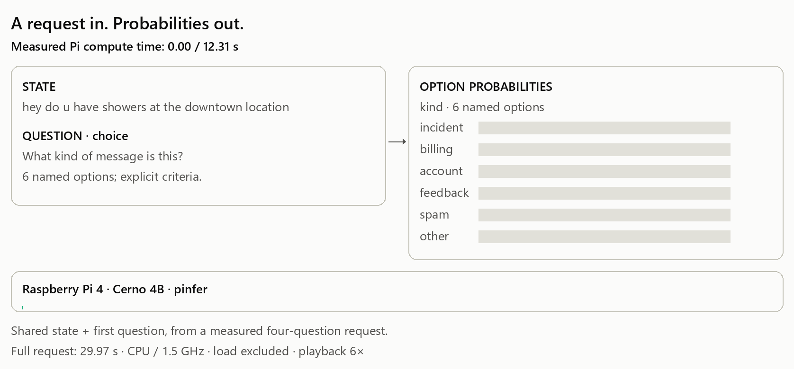
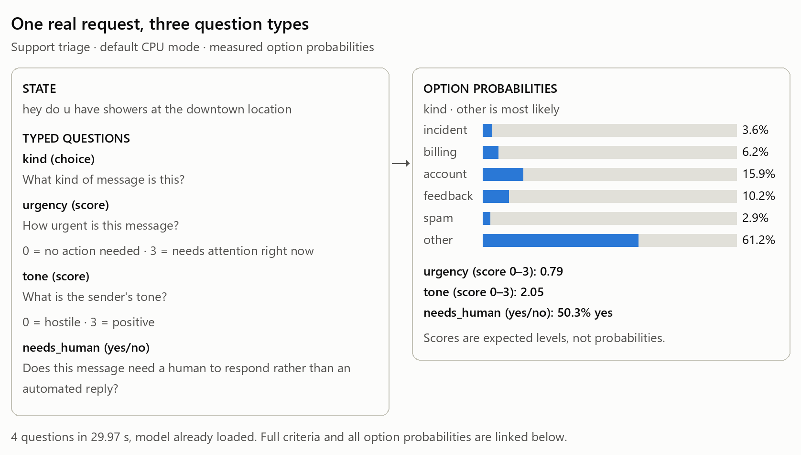
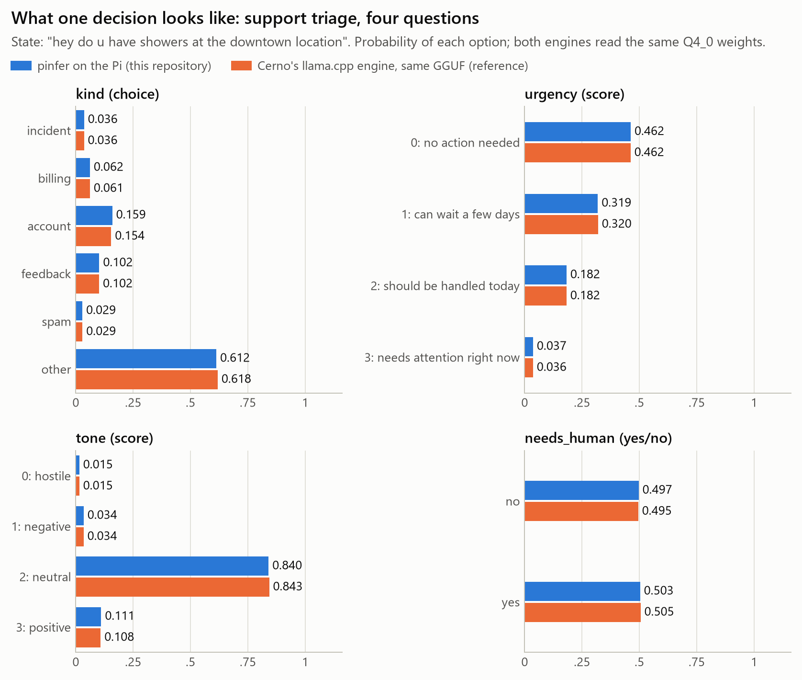
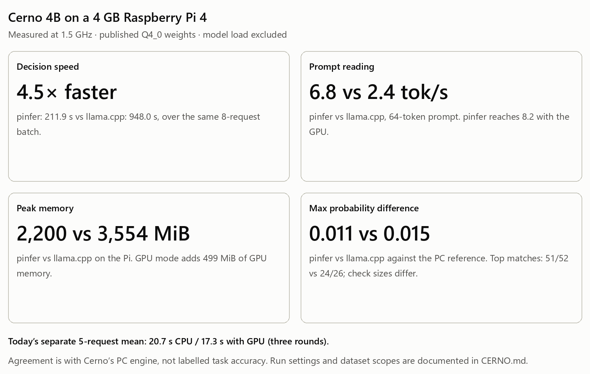
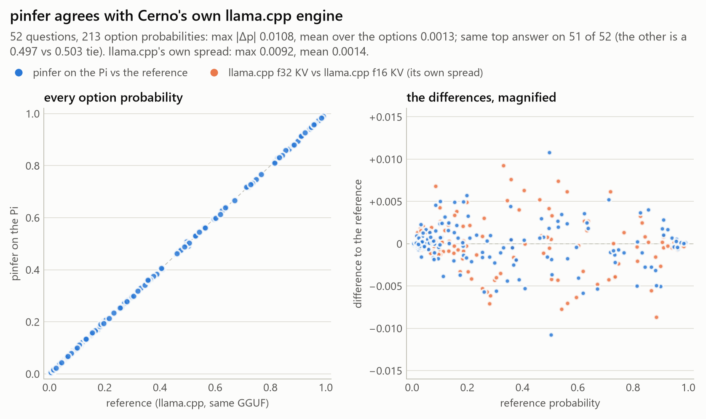
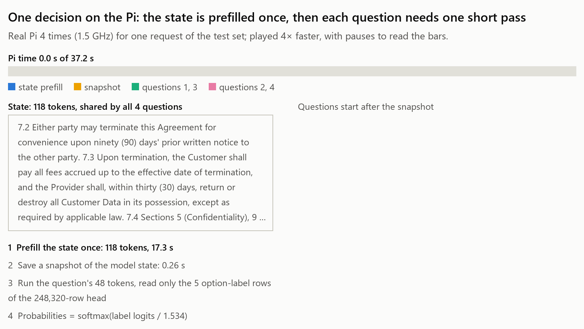
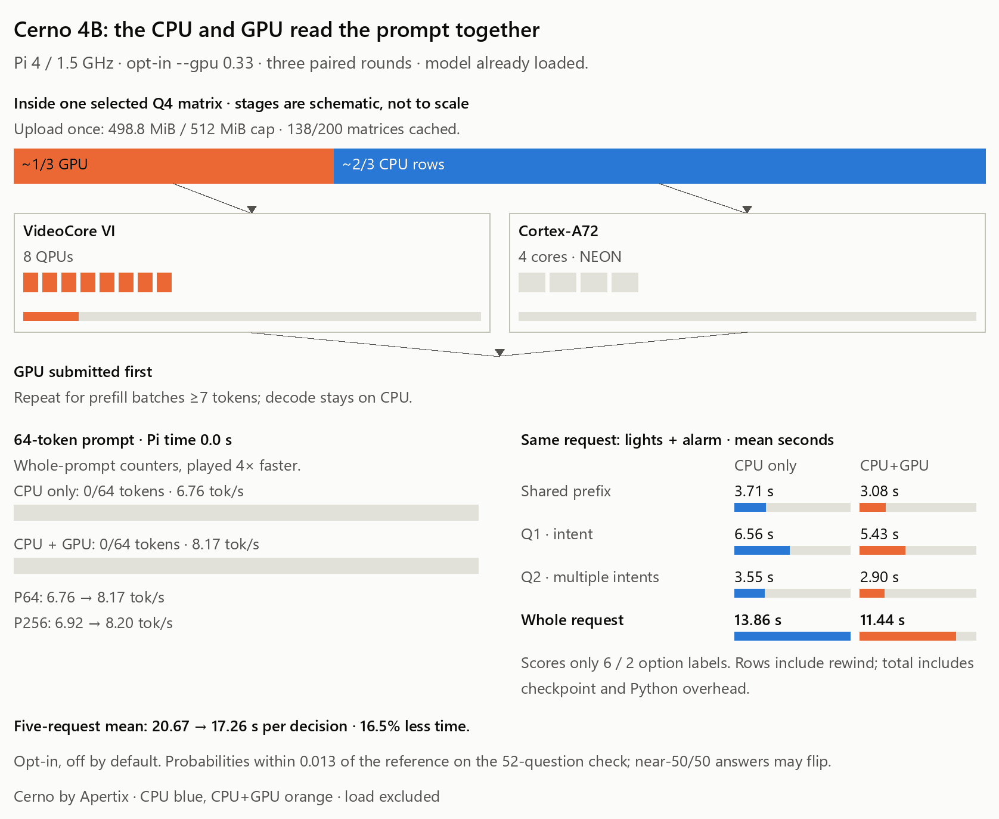

<p align="center">
<picture>
  <source media="(max-width: 600px) and (prefers-color-scheme: dark)" srcset="docs/assets/logo-mobile-dark.svg">
  <source media="(max-width: 600px)" srcset="docs/assets/logo-mobile.svg">
  <source media="(prefers-color-scheme: dark)" srcset="docs/assets/logo-dark.svg">
  
</picture>
</p>

<h1 align="center">cerno-pi</h1>
<p align="center"><strong>Typed questions. Calibrated probabilities. On a Raspberry Pi.</strong></p>

<p align="center">
  <a href="LICENSE"></a>
  <a href="#results-on-the-pi"></a>
  <a href="https://huggingface.co/apertixai/cerno-4b"></a>
  <a href="https://github.com/Optimizer077/nibblepi"></a>
</p>

<p align="center"><a href="#quickstart">Quickstart</a> · <a href="#what-is-cerno">Cerno explained</a> · <a href="#results-on-the-pi">Results</a> · <a href="#how-it-works">How it works</a> · <a href="#credit-and-licence">Credit</a></p>

<picture>
  <source media="(max-width: 600px) and (prefers-color-scheme: dark)" srcset="docs/figures/hero-mobile-dark.gif">
  <source media="(max-width: 600px)" srcset="docs/figures/hero-mobile.gif">
  <source media="(prefers-color-scheme: dark)" srcset="docs/figures/hero-dark.gif">
  
</picture>

An independent Pi port of **Apertix's Cerno 4B**, powered by
[pinfer](https://github.com/Optimizer077/nibblepi). Give it a state and a question with explicit
options; get a probability for each option. The measured first answer above takes **12.31 s**
of shared-state and question computation, with the model already loaded.

## What is Cerno?

**Cerno is a family of decision models by Apertix**, available in 27B, 9B and 4B sizes.
This port runs **Cerno 4B**, based on Qwen3.5-4B. A model answers each typed question with
calibrated option probabilities in one forward pass, without generating free-form text.
[Model card](https://huggingface.co/apertixai/cerno-4b),
[original inference code](https://github.com/apertixsk/cerno-inference).

| You ask | Example | You receive |
|---|---|---|
| **Choice** | Billing, account, feedback or other? | A probability for every named option |
| **Yes/no** (`noul`) | Does this need a human? | Probabilities for no and yes |
| **Score** | How urgent is it, on levels 0–3? | A distribution over the levels and an expected score |

With local weights, inference runs on the Pi. That makes the same small device useful for local
message routing, support triage and tool-call checks. You supply the state and criteria; your
application uses the returned probabilities. The weights are downloaded separately.

### Jev, System One and the Decision Index

**Jev 1.13 is TypeSafe AI's decision model.** *System One* is TypeSafe AI's name for its typed
decision interface. The Cerno card calls its approach “Jev-style System One”; decider's
[System One adapter](https://github.com/apertixsk/cerno-inference/blob/9941548d836ff53b56e326860f94b93adc79bee9/third_party/decider/decider/systemone.py)
shows the state + typed-questions request shape. Cerno follows that structured scoring style.

The **Decision Index 0.3 public suite** contains 37 benchmarks and 140,178 requests.
Apertix's v1.1 [model card](https://huggingface.co/apertixai/cerno-4b#results)
(19 October 2026) reports:

| Published artifact | Complete public index |
|---|---:|
| Cerno 4B, FP8 | **57.60** |
| Jev 1.13, TypeSafe | 57.96 |
| Cerno 4B, 4-bit GGUF / llama.cpp | 57.23 |

These are reported public-suite results, separate from this port's Pi latency and compatibility
checks. They are not the Index's headline full score. See the
[Decision Index](https://github.com/apolinario/decision-index) and the
[Cerno GGUF card](https://huggingface.co/apertixai/cerno-4b-GGUF).

## What a decision looks like

This is a **real measured request**, with the original customer message and four typed questions.
Each question has its own criteria. A score such as urgency 0.79 is an expected level on the
specified 0–3 scale; a yes/no value is a probability.

<picture>
  <source media="(max-width: 600px) and (prefers-color-scheme: dark)" srcset="docs/figures/decision_request-mobile-dark.png">
  <source media="(max-width: 600px)" srcset="docs/figures/decision_request-mobile.png">
  <source media="(prefers-color-scheme: dark)" srcset="docs/figures/decision_request-dark.png">
  
</picture>

[Run this request](examples/support-triage.json) ·
[All test requests](requests/correctness.json) ·
[Reference and timing files](CERNO.md#6-pi-measurements)

<details>
<summary>Every option, next to Cerno's PC reference</summary>

<picture>
  <source media="(max-width: 600px) and (prefers-color-scheme: dark)" srcset="docs/figures/decision_example-mobile-dark.png">
  <source media="(max-width: 600px)" srcset="docs/figures/decision_example-mobile.png">
  <source media="(prefers-color-scheme: dark)" srcset="docs/figures/decision_example-dark.png">
  
</picture>

The option probabilities come from the published Q4_0 weights on both engines. All token IDs match.

</details>

## Results on the Pi

Raspberry Pi 4, **4 GB**, Cortex-A72 at **1.5 GHz**, four threads. The published Q4_0 / Q8_0
blocks are converted losslessly to pinfer's format. The weights stay on their original grid.

<picture>
  <source media="(max-width: 600px) and (prefers-color-scheme: dark)" srcset="docs/figures/results_scorecard-mobile-dark.png">
  <source media="(max-width: 600px)" srcset="docs/figures/results_scorecard-mobile.png">
  <source media="(prefers-color-scheme: dark)" srcset="docs/figures/results_scorecard-dark.png">
  
</picture>

| Measurement | CPU, default | CPU + GPU, opt-in | llama.cpp on the same Pi |
|---|---:|---:|---:|
| Today's mean seconds/decision, 5 requests × 3 rounds | **20.67** | **17.26** | — |
| 64-token prompt, tokens/s, 3-round pinfer means | 6.76 | **8.17** | 2.43 |
| 256-token prompt, tokens/s, 3-round pinfer means | 6.92 | **8.20** | 2.45 |
| Recorded peak process memory, MiB | ~2,200 | ~2,200 + **499 MiB GPU memory** | 3,554 |
| Top answers matching the PC reference | **51/52** | 50/52 | 24/26 |
| Earlier matched 8-request batch, total seconds | **211.9** | — | 948.0 |

**GPU mode is off by default.** The recommended enabled share is `gpu_split=0.33` in
`pinfer.Model.load`. It saves 16.5% of decision time on the measured five-request set, adds about
499 MiB of GPU memory, and raises model-load time from about 2.7 to 6.8 s, paid once.
On the 52-question check its maximum probability difference from the reference is 0.01275;
two near-50/50 answers flip. CPU-only remains the default.

<details>
<summary>Read the numbers and reproduce the comparisons</summary>

- **4.5×** is the ratio of total times on the earlier eight matched requests (26 questions),
  not a ratio of the two medians. Source: [speed_vs_llama.json](results/speed_vs_llama.json).
- **20.67 / 17.26 s** is today's separate five-request, 13-question set, with checkpoint enabled
  in both arms and model load excluded. 64/256-token prompt mean rates are from three rounds.
  Sources: [CERNO.md](CERNO.md#7-optimizations-and-their-measured-effect),
  [engine GPU measurements](https://github.com/Optimizer077/nibblepi/blob/main/engine/GPU.md),
  [figure inputs](tools/animation_measurements.py).
- **Memory** is recorded process peaks in MiB. GPU memory is additional to that process peak.
  Runs and context settings are listed in [CERNO.md](CERNO.md#6-pi-measurements).
- **Agreement** compares numerical outputs, not labelled task accuracy: 52 questions / 213 options
  against Cerno's PC llama.cpp engine; the Pi llama.cpp check covers 26 questions. CPU max
  probability difference is 0.0108. Sources: [CPU comparison](results/compare_all_reuse2.json)
  and [GPU measurements](https://github.com/Optimizer077/nibblepi/blob/main/engine/GPU.md).
- Our [18-request test set](requests/correctness.json) was written for this port, with AI assistance;
  it is a correctness and latency set, not Decision Index benchmark data. The Decision Index
  model-quality evaluation is a separate published run.

<picture>
  <source media="(max-width: 600px) and (prefers-color-scheme: dark)" srcset="docs/figures/agreement-mobile-dark.png">
  <source media="(max-width: 600px)" srcset="docs/figures/agreement-mobile.png">
  <source media="(prefers-color-scheme: dark)" srcset="docs/figures/agreement-dark.png">
  
</picture>

</details>

## How it works

1. **Keep the published quantization.** Convert the GGUF without re-quantizing; `--verify` checks
   every copied block.
2. **Read the shared state once.** Checkpoint the model inside the engine; rewind before each
   later question. The cached prefix stays in place.
3. **Score the options.** Compute only the answer-label rows and apply Cerno's calibration
   temperature (4B: 1.534). Return typed answers and probabilities.

<picture>
  <source media="(max-width: 600px) and (prefers-color-scheme: dark)" srcset="docs/figures/decision_flow-mobile-dark.gif">
  <source media="(max-width: 600px)" srcset="docs/figures/decision_flow-mobile.gif">
  <source media="(prefers-color-scheme: dark)" srcset="docs/figures/decision_flow-dark.gif">
  
</picture>

### Optional: let the GPU read too

The VideoCore VI GPU units (QPUs) process about one third of the rows of selected large matrices while the
four CPU cores compute the remainder. The results join before the next matrix. Weights are
uploaded once within a **512 MiB limit for GPU memory**; single-token steps stay on the CPU. If GPU setup is unavailable,
or a submit/wait fails, pinfer warns and continues on CPU.

<picture>
  <source media="(max-width: 600px) and (prefers-color-scheme: dark)" srcset="docs/figures/decision_gpu-mobile-dark.gif">
  <source media="(max-width: 600px)" srcset="docs/figures/decision_gpu-mobile.gif">
  <source media="(prefers-color-scheme: dark)" srcset="docs/figures/decision_gpu-dark.gif">
  
</picture>

Enable it through the Python API (pinfer 0.3):

```python
import json
import pinfer
from cerno_pi import Decider

path = "examples/support-triage.json"
with open(path) as f:
    request = json.load(f)
with pinfer.Model.load(
    "cerno-4b-q4_0.pq",
    max_ctx=512, gpu_split=0.33
) as model:
    result = Decider(model).decide(
        request["state"],
        request["questions"]
    )
    print(result.answers)
```

The engine's `pinfer_run` flag is `--gpu 0.33`. The regular cerno-pi quickstart below uses CPU-only.

## Quickstart

### 1. Install the engine on the Pi

Use a 64-bit Pi 4 OS and install an aarch64 **pinfer wheel** using the
[Pi installation guide](https://github.com/Optimizer077/nibblepi/blob/main/docs/library.md).
pinfer is not currently distributed on PyPI; build/copy the wheel as described there.
Use pinfer 0.3 for the optional GPU API.

### 2. Get the weights and convert on a PC

Download `cerno-4b-v1.1-q4_0.gguf` from
[Apertix's GGUF repository](https://huggingface.co/apertixai/cerno-4b-GGUF), plus the tokenizer
files and `decider_config.json` from the [4B model](https://huggingface.co/apertixai/cerno-4b),
into a local `cerno-4b/` directory. The converter belongs to **nibblepi**:

```bash
git clone \
  https://github.com/Optimizer077/nibblepi
python nibblepi/tools/gguf_to_pq.py \
  cerno-4b-v1.1-q4_0.gguf \
  cerno-4b-q4_0.pq \
  --tokenizer cerno-4b/ --verify
```

Copy `cerno-4b-q4_0.pq` and its `cerno-4b-q4_0.tokenizer/` sidecar to the Pi.
Weights are not included or redistributed here; obtain them under their published terms.

### 3. Ask the measured example

On the Pi, with pinfer installed and the model files in place:

```bash
git clone \
  https://github.com/Optimizer077/cerno-pi
cd cerno-pi
python -m pip install .
cerno-pi decide \
  -m /path/to/cerno-4b-q4_0.pq \
  --ctx 512 \
  --request examples/support-triage.json \
  --timing
```

The JSON output contains a probability for every option. For your own request, supply a
`state` and `questions` object in the same shape. You can also use
`from cerno_pi import Decider` with a loaded pinfer model.

<details>
<summary>API options and repository map</summary>

- `choice`: named criteria, up to 255 options; `noul`: yes/no; `score`: 2–10 ordered levels.
- `--no-reuse`: score each row from scratch; `--top-n 260`: emulate the reference's top-260
  probability list (reads the full output head); `--tokenization ids`: use decider's IDs.
- `bench/decide_bench.py --no-checkpoint` selects the older model-state copying method for comparisons.
- [cerno_pi/decide.py](cerno_pi/decide.py): protocol, calibration and shared-prefix reuse.
- [bench/](bench/): reference runners and comparisons. [results/](results/): raw measurements.
- [CERNO.md](CERNO.md): sources, revisions, licence notes and the measurement notebook.

</details>

## Credit and licence

Cerno is **not** our work. All credit for the models, their training, the decision protocol and the
evaluation belongs to their authors:

- **Cerno models and inference code** — Apertix:
  [github.com/apertixsk/cerno-inference](https://github.com/apertixsk/cerno-inference) (Apache-2.0),
  model cards [apertixai/cerno-4b](https://huggingface.co/apertixai/cerno-4b) and
  [apertixai/cerno-4b-GGUF](https://huggingface.co/apertixai/cerno-4b-GGUF) on Hugging Face.
  Cerno 4B is built on Qwen3.5-4B (Qwen team, Alibaba).
- **Prompt layout and typed questions** — [decider](https://github.com/Mapika/decider) (Apache-2.0),
  as vendored in cerno-inference.

This repository is an independent port of their scoring protocol to the Pi, with the exact commits it
was derived from listed in [NOTICE](NOTICE). It is not affiliated with or endorsed by Apertix, the
decider authors, TypeSafe AI or the Decision Index maintainers.

The code here is **Apache-2.0** ([LICENSE](LICENSE)); adapted components and exact revisions are
listed in [NOTICE](NOTICE). Model weights are separate and remain subject to their published terms.
Jev and System One are TypeSafe AI's names.

## Links

[Cerno inference](https://github.com/apertixsk/cerno-inference) ·
[Cerno 4B](https://huggingface.co/apertixai/cerno-4b) ·
[4B GGUF](https://huggingface.co/apertixai/cerno-4b-GGUF) ·
[decider](https://github.com/Mapika/decider) ·
[Decision Index](https://github.com/apolinario/decision-index) ·
[pinfer / nibblepi](https://github.com/Optimizer077/nibblepi)
